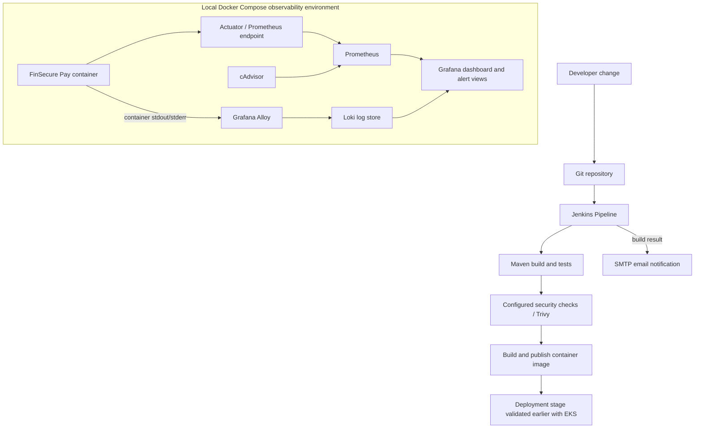

# FinSecure Pay Architecture

## Overview

The project demonstrates an application delivery path and a separate local observability path. Jenkins builds and tests the application and runs the configured security/image workflow. The local Docker Compose stack provides live application/container metrics, dashboards, alert rules, log forwarding, centralized log storage, and log querying.

The EKS deployment is represented as a previously validated delivery target. For cost control, the final local demo does not require starting the EKS cluster.

## Main components

| Component | Responsibility |
|---|---|
| Spring Boot application | Serves health and payment-validation endpoints, with Actuator metrics enabled for monitoring |
| Maven / JUnit | Builds the application and runs automated tests |
| Docker | Packages the application into a container image |
| Jenkins | Orchestrates the build/test/security/image workflow and sends build notifications |
| Trivy | Scans dependencies/filesystem and the built container image according to the configured pipeline steps |
| Prometheus | Scrapes application and infrastructure metrics and evaluates configured alert rules |
| cAdvisor | Exposes container-level metrics to Prometheus |
| Grafana | Visualizes metrics and provides Explore for log investigation |
| Alloy | Collects and forwards container/application logs |
| Loki | Stores logs for centralized querying |
| SMTP / Email Extension | Delivers Jenkins build-result notifications |

## Signals and troubleshooting flow

1. **Metrics:** The application exposes `/actuator/prometheus`. Prometheus scrapes that endpoint and cAdvisor; Grafana displays the resulting time series.
2. **Alerts:** Prometheus evaluates the alert rules in the `monitoring/` configuration. A firing alert should be checked against its expression and current target health.
3. **Logs:** Alloy forwards container logs to Loki. Engineers use Grafana Explore and LogQL to search the appropriate stream and identify error messages around the incident time.
4. **Build notifications:** Jenkins uses the Email Extension Plugin and its configured SMTP connection to notify the recipient of a Pipeline result.

## Security boundaries

- Application and monitoring secrets are kept in local environment configuration or Jenkins Credentials, not source code.
- `.env.monitoring` must stay untracked.
- The Jenkins container has access to `/var/run/docker.sock` for Docker build operations. This is a privileged integration; keep the service local and access-controlled.
- The dashboard and log queries are for the development/demo environment, not a claim of production hardening.
