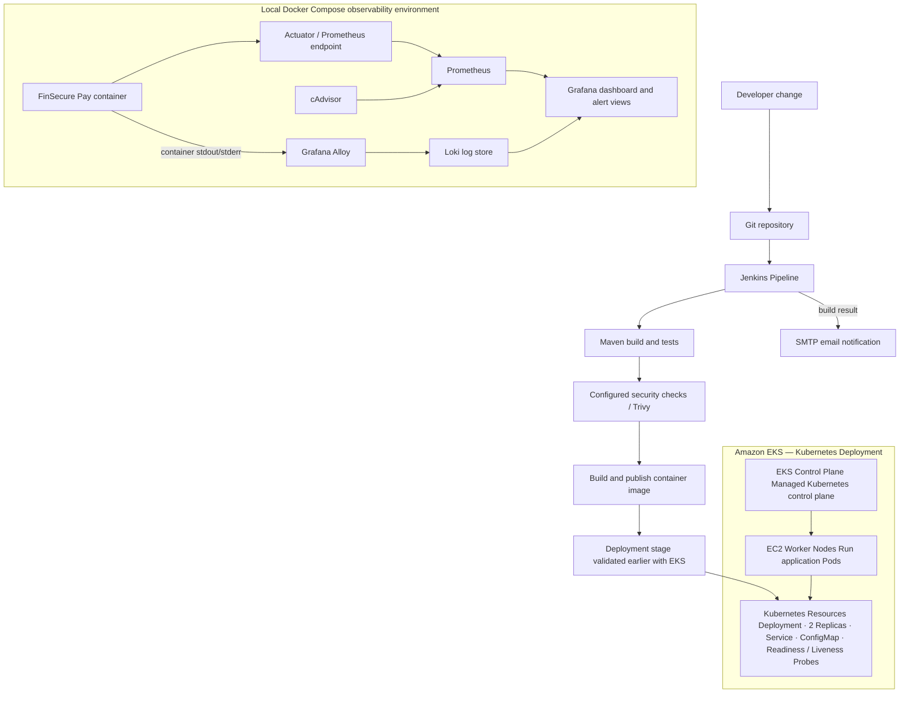

# FinSecure Pay Architecture

## Overview

The project demonstrates an application delivery path and a separate local observability path.

The application delivery pipeline uses Jenkins to build and test the Spring Boot application, perform security scanning with Trivy, and build and publish Docker images. The application was deployed and validated on Amazon EKS, using Kubernetes Deployments, Services, ConfigMaps, and health probes to manage application instances, configuration, and availability.

The EKS environment was provisioned using eksctl, with Amazon EC2 worker nodes, while Kubernetes resources were managed and validated using kubectl. The deployment demonstrated multiple replicas, application health checks, and automatic Pod recovery.

Separately, the local Docker Compose observability stack provides application and container metrics, dashboards, alert rules, log forwarding, centralized log storage, and log querying through Prometheus, Grafana, Alloy, and Loki.

This separation allows the project to demonstrate cloud-based application deployment while maintaining a cost-controlled local environment for monitoring and operational demonstrations.

## Main components

| Component | Responsibility |
|---|---|
| Spring Boot application | Serves health and payment-validation endpoints, with Actuator metrics enabled for monitoring |
| Maven / JUnit | Builds the application and runs automated tests |
| Docker | Packages the application into a container image |
| Jenkins | Orchestrates the build/test/security/image workflow and sends build notifications |
| Trivy | Scans dependencies/filesystem and the built container image according to the configured pipeline steps |
| Amazon EKS | Provides the managed Kubernetes control plane for orchestrating the application deployment |
| Amazon EC2 Worker Nodes | Provide compute resources to run the Kubernetes application Pods |
| Kubernetes Deployment | Maintains the desired application replica count and replaces failed Pods |
| Prometheus | Scrapes application and infrastructure metrics and evaluates configured alert rules |
| cAdvisor | Exposes container-level metrics to Prometheus |
| Grafana | Visualizes metrics and provides Explore for log investigation |
| Alloy | Collects and forwards container/application logs |
| Loki | Stores logs for centralized querying |
| SMTP / Email Extension | Delivers Jenkins build-result notifications |

## Signals and troubleshooting flow

1. **Metrics:** The application exposes `/actuator/prometheus`. Prometheus scrapes that endpoint and cAdvisor; Grafana displays the resulting time series.
2. **Alerts:** Prometheus evaluates the alert rules in the `monitoring/` configuration. A firing alert should be checked against its expression and current target health.
3. **Logs:** Alloy forwards container logs to Loki. Engineers use Grafana Explore and LogQL to search the appropriate stream and identify error messages around the incident time.
4. **Build notifications:** Jenkins uses the Email Extension Plugin and its configured SMTP connection to notify the recipient of a Pipeline result.
5. **Kubernetes cluster and worker nodes:** Run the `kubectl` to get the cluster information and node groups

## Security boundaries

- Application and monitoring secrets are kept in local environment configuration or Jenkins Credentials, not source code.
- `.env.monitoring` must stay untracked.
- The Jenkins container has access to `/var/run/docker.sock` for Docker build operations. This is a privileged integration; keep the service local and access-controlled.
- The dashboard and log queries are for the development/demo environment, not a claim of production hardening.
