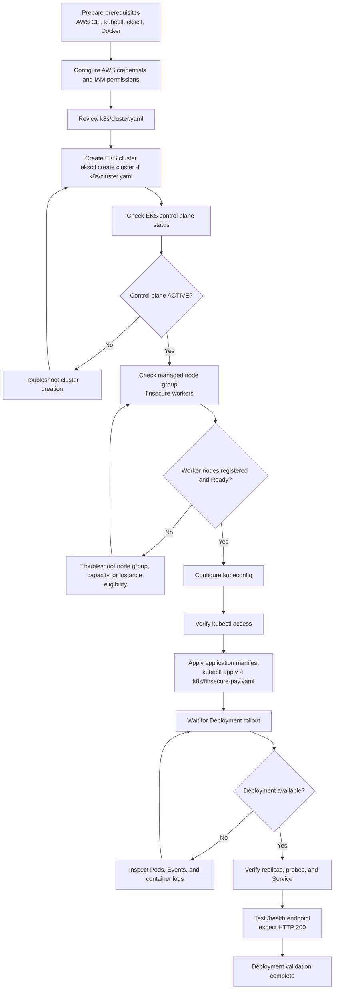
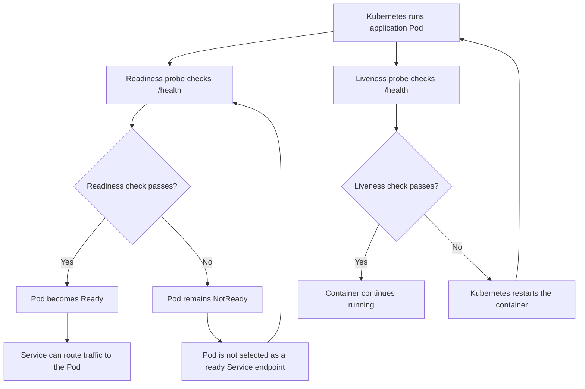
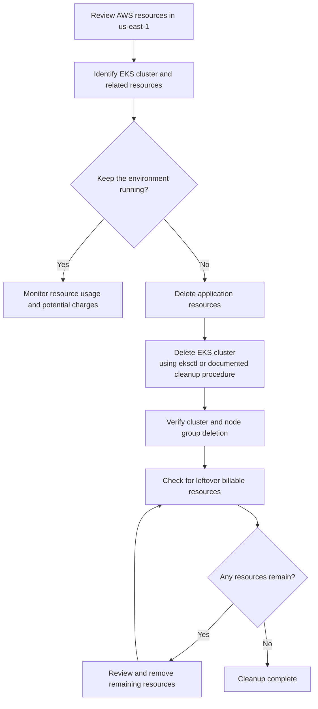
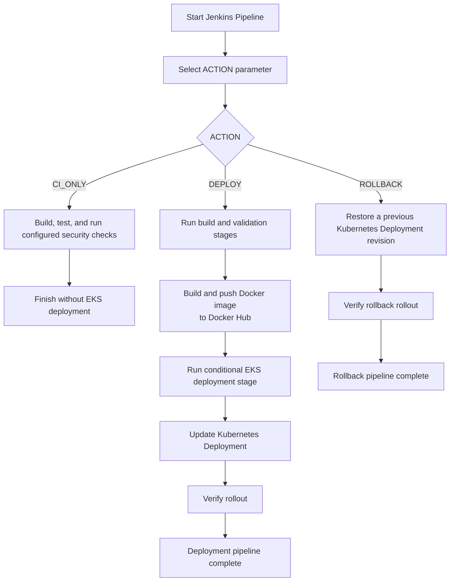

# EKS Deployment Guide

This document describes how to deploy the FinSecure Pay application to Amazon Elastic Kubernetes Service (EKS) using the Kubernetes manifests in this repository.

> **Cost Warning:** Amazon EKS incurs charges while the cluster control plane exists, even when no application Pods are running. Worker nodes, load balancers, NAT gateways, storage, and data transfer may incur additional charges. Review the AWS pricing and resource configuration before creating infrastructure.

## 1. Deployment Overview



The project uses Amazon EKS to deploy the FinSecure Pay application.

| Component | Configuration |
|---|---|
| Cloud Provider | AWS |
| AWS Region | `us-east-1` |
| EKS Cluster | `finsecure-capstone` |
| Kubernetes Version | `1.37` |
| Managed Node Group | `finsecure-workers` |
| Application Image | `brucechoutw/finsecure-pay:1.0.0` |
| Cluster Configuration | `k8s/cluster.yaml` |
| Application Manifest | `k8s/finsecure-pay.yaml` |

The EKS cluster provides the Kubernetes control plane, while the managed node group provides worker capacity for running application Pods.

## 2. Prerequisites

Install the following tools on the deployment machine:

- AWS CLI
- kubectl
- eksctl
- Docker (required only when building or publishing a new application image)

You also need:

1. An AWS account with valid credentials.
2. IAM permissions to create and manage EKS clusters, node groups, and related AWS resources.
3. Access to the Docker image repository if using a private image.
4. The project repository cloned locally.

Check the installed tool versions:

```bash
aws --version
kubectl version --client
eksctl version
docker --version
```

Configure AWS credentials if they have not already been configured:

```bash
aws configure
```

Verify the active AWS identity:

```bash
aws sts get-caller-identity
```

Set the AWS region:

```bash
export AWS_REGION=us-east-1
export AWS_DEFAULT_REGION=us-east-1
```

Review the cluster configuration before creating any infrastructure:

```bash
cat k8s/cluster.yaml
```

## 3. Create the EKS Cluster

Before creating the cluster, review `k8s/cluster.yaml` and verify:

- Kubernetes version
- AWS region
- Node group instance type
- Node group scaling configuration
- Availability Zone and subnet configuration

Instance availability and pricing vary by region and over time. Do not assume that an instance type is eligible for a free tier or available in every Availability Zone.

Create the cluster and its configured managed node group:

```bash
eksctl create cluster -f k8s/cluster.yaml
```

This command creates AWS infrastructure and may take several minutes. AWS charges may apply.

Check the cluster status:

```bash
aws eks describe-cluster \
  --name finsecure-capstone \
  --region "$AWS_REGION" \
  --query 'cluster.status' \
  --output text
```

A status of `ACTIVE` confirms that the EKS control plane is active. It does not independently confirm that worker nodes are ready.

List the managed node groups:

```bash
aws eks list-nodegroups \
  --cluster-name finsecure-capstone \
  --region "$AWS_REGION"
```

Check the managed node group status:

```bash
aws eks describe-nodegroup \
  --cluster-name finsecure-capstone \
  --nodegroup-name finsecure-workers \
  --region "$AWS_REGION" \
  --query 'nodegroup.status' \
  --output text
```

## 4. Configure kubectl Access

Update the local kubeconfig to connect to the project cluster:

```bash
aws eks update-kubeconfig \
  --region "$AWS_REGION" \
  --name finsecure-capstone
```

Verify the current Kubernetes context:

```bash
kubectl config current-context
kubectl cluster-info
```

Check whether worker nodes have joined the cluster:

```bash
kubectl get nodes -o wide
```

Proceed with application deployment only when the required worker nodes are in the `Ready` state.

## 5. Deploy FinSecure Pay

From the repository root, apply the application manifest:

```bash
kubectl apply -f k8s/finsecure-pay.yaml
```

Check the Kubernetes resources:

```bash
kubectl get deployments
kubectl get pods -o wide
kubectl get services
```

Monitor the deployment rollout:

```bash
kubectl rollout status deployment/finsecure-pay
```

If the Deployment resource has a different name, use the value of `metadata.name` defined in `k8s/finsecure-pay.yaml`.

Inspect deployment details and recent events:

```bash
kubectl describe deployment finsecure-pay
kubectl describe pods
kubectl get events --sort-by=.metadata.creationTimestamp
```

## 6. Verify Application Health and Service Access

The FinSecure Pay application exposes a health endpoint at:

```text
/health
```

First, inspect the Service configuration:

```bash
kubectl get services
kubectl describe service
```

For a `ClusterIP` Service, use port forwarding to access the application locally.

Replace `<service-port>` with the actual Service port defined in the manifest:

```bash
kubectl port-forward service/finsecure-pay 8080:<service-port>
```

In another terminal, test the health endpoint:

```bash
curl -i http://localhost:8080/health
```

The expected result for a healthy application is an HTTP `200` response.

If the manifest uses a `LoadBalancer` Service, retrieve its external address:

```bash
kubectl get services
```

Then access the health endpoint using the assigned address and exposed Service port.

> Note: A Kubernetes LoadBalancer Service may create additional billable AWS resources.

## 7. Validate Replicas and Health Probes



The project deployment was validated with two application replicas and Kubernetes readiness and liveness probes.

Check the Deployment and Pod status:

```bash
kubectl get deployment finsecure-pay
kubectl get pods -o wide
```

Inspect the health probe configuration:

```bash
kubectl describe pod <pod-name>
```

The deployment manifest configures HTTP health checks using the `/health` endpoint.

- **Readiness Probe:** Determines whether a Pod is ready to receive application traffic.
- **Liveness Probe:** Detects an unhealthy container and allows Kubernetes to restart it.

To inspect application logs:

```bash
kubectl logs <pod-name> --tail=100
```

To follow logs continuously:

```bash
kubectl logs -f <pod-name>
```

## 8. Rollout and Rollback

After updating the application image or Deployment manifest, apply the updated configuration:

```bash
kubectl apply -f k8s/finsecure-pay.yaml
```

Monitor the rollout:

```bash
kubectl rollout status deployment/finsecure-pay
kubectl rollout history deployment/finsecure-pay
```

If the new revision is unhealthy, restore the previous Deployment revision:

```bash
kubectl rollout undo deployment/finsecure-pay
```

Verify the rollback:

```bash
kubectl rollout status deployment/finsecure-pay
kubectl get pods
kubectl describe deployment finsecure-pay
```

Use the actual Deployment name from the manifest if it differs from `finsecure-pay`.

## 9. Troubleshooting

### 9.1 EKS Cluster Is ACTIVE but No Worker Nodes Are Available

The EKS control plane and worker node group have separate statuses.

Check the managed node groups:

```bash
aws eks list-nodegroups \
  --cluster-name finsecure-capstone \
  --region "$AWS_REGION"
```

Check Kubernetes nodes:

```bash
kubectl get nodes
```

If the node group is missing or failed to create, inspect its CloudFormation stack and EKS node group status.

Review the following possible causes:

- EC2 instance type availability
- Availability Zone capacity
- Subnet IP address capacity
- IAM permissions
- AWS service quotas
- Node group provisioning errors

Do not repeatedly recreate the node group without identifying the original failure reason.

### 9.2 Pods Remain Pending

Check worker node readiness and scheduling events:

```bash
kubectl get nodes
kubectl describe pod <pod-name>
kubectl get events --sort-by=.metadata.creationTimestamp
```

Possible causes include:

- No ready worker nodes
- Insufficient CPU or memory resources
- Scheduling constraints
- Node group provisioning issues

### 9.3 ImagePullBackOff or ErrImagePull

Inspect the Pod events:

```bash
kubectl describe pod <pod-name>
```

Verify that the image name and tag in the Deployment manifest are correct.

For private container registries, ensure the cluster has the required image-pull credentials.

### 9.4 Pods Are Not Ready or Keep Restarting

Inspect the Pod details and application logs:

```bash
kubectl describe pod <pod-name>
kubectl logs <pod-name> --previous
kubectl get events --sort-by=.metadata.creationTimestamp
```

Verify that:

- The application starts successfully.
- The `/health` endpoint returns HTTP `200`.
- The probe port matches the application's listening port.
- The readiness and liveness probe configurations are correct.

### 9.5 AWS CLI or kubectl Authorization Errors

Verify the active AWS identity:

```bash
aws sts get-caller-identity
```

Check access to the EKS cluster:

```bash
aws eks describe-cluster \
  --name finsecure-capstone \
  --region "$AWS_REGION"
```

Check Kubernetes authorization:

```bash
kubectl auth can-i get pods
```

Also verify that kubeconfig points to the intended cluster and that the IAM principal is authorized for Kubernetes access.

## 10. Cost Control and Resource Cleanup



EKS and its supporting AWS resources can continue to incur charges even when the application is idle.

Before pausing or finishing the project:

1. Identify all AWS resources created for this project.
2. Check for EKS clusters, managed node groups, EC2 instances, load balancers, NAT gateways, EBS volumes, and other associated resources.
3. Delete resources that are no longer required.
4. Verify in the AWS Console or CLI that the resources have actually been removed.

Delete the application resources:

```bash
kubectl delete -f k8s/finsecure-pay.yaml
```

Delete the EKS cluster and resources managed by eksctl:

```bash
eksctl delete cluster \
  --name finsecure-capstone \
  --region "$AWS_REGION"
```

Wait for the deletion process to complete.

Verify the cluster status:

```bash
aws eks describe-cluster \
  --name finsecure-capstone \
  --region "$AWS_REGION"
```

A `ResourceNotFoundException` after deletion indicates that the cluster is no longer present.

Also inspect the AWS Console for leftover resources that may not have been removed automatically.

Do not delete shared AWS resources belonging to other workloads.

## 11. Deployment Evidence

The `evidence/task3-eks/` directory contains the project evidence for EKS deployment and validation.

Relevant artifacts include:

- Kubernetes deployment and service configuration.
- Deployment status, node, and Pod snapshots.
- Two-replica deployment verification.
- Readiness and liveness probe configuration.
- Service configuration and application access tests.
- Automatic Pod recovery validation.

These artifacts document the successful deployment and validation exercise.

An `ACTIVE` EKS cluster status alone should not be treated as proof of successful application deployment. Worker node readiness and running application Pods should also be included as evidence.

## 12. CI/CD Integration



The project integrates EKS deployment with the Jenkins CI/CD pipeline.

The Jenkins pipeline supports the following execution modes:

| Action | Description |
|---|---|
| `CI_ONLY` | Executes CI checks without deploying to EKS. |
| `DEPLOY` | Enables the EKS deployment stage. |
| `ROLLBACK` | Restores a previous Kubernetes Deployment revision. |

The deployment stage is conditional. Not every Jenkins pipeline execution creates or updates EKS resources.

For cost control, the pipeline was adjusted to prevent unnecessary EKS deployments during normal CI execution.

Select the deployment action only when an EKS deployment is intentionally required and the expected AWS charges are understood.

## 13. Project Notes

- The EKS deployment is separate from the local Docker Compose monitoring stack.
- Prometheus, Grafana, Grafana Alloy, and Loki are used in the local monitoring environment rather than being deployed inside the EKS cluster.
- The application health endpoint is used by Kubernetes readiness and liveness probes.
- Previously captured deployment evidence is retained in the repository to demonstrate the successful EKS deployment and validation process.
- Recreating the EKS infrastructure is not required for reviewing the existing deployment evidence.
